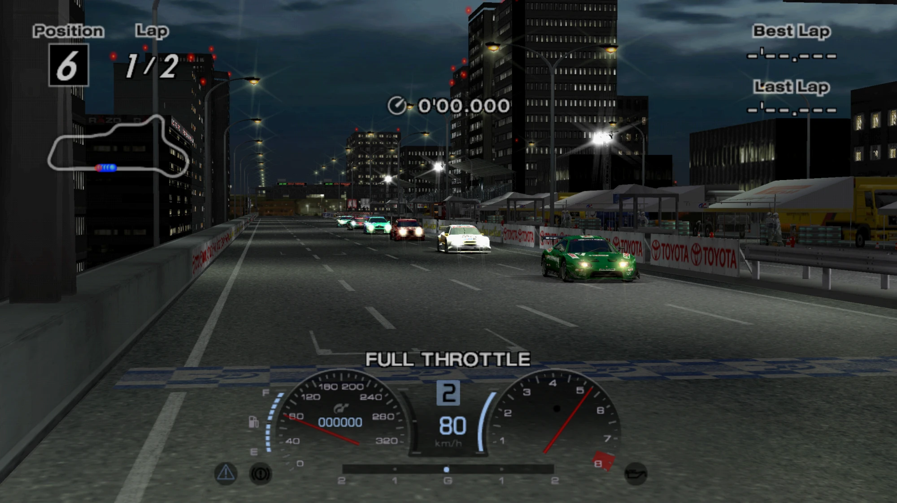

# GT4Recomp

**Gran Turismo 4, recompiled to run natively on PC.** 
No JIT, no emulator window, full speed.

-100%25%20AOT-2ea44f)

 

GT4Recomp is a static recompilation of **Gran Turismo 4 (NTSC-U, SCUS-97328)** for **Windows x86-64**.
The game's own code is translated ahead of time into C++ and compiled to native machine code; the PS2
hardware it talks to is reproduced in software, and graphics run on **Vulkan**. Nothing generates code
while the game runs, which is also what makes future **Android and iOS** builds possible.

## ✨ Highlights

- 🏁 **Locked 60 FPS at 100% game speed** in every scene we test, with a frame every **16.7 ms**.
- ⚙️ **All game code is precompiled:** the main CPU (EE) and every VU1 and VU0 microprogram run as native
  code, with no interpreter on the normal path.
- 🖥️ **Sharp, high-resolution image:** **1080p** out of the box, with **1440p, 4K and 8K** available. The game
  is rendered at that resolution, not just stretched, in **16:9** with borderless fullscreen.
- 🎨 **PCSX2 GS renderer** in its own process: crisp deinterlaced menus, FXAA and sharpening, and a built-in
  performance overlay. **CoreGS 1.1** is built in as the fallback.
- 💾 **Crash-safe memory card:** saves survive a crash or a forced close.
- 🚀 **Next:** a one-click **launcher and installer**, then the first stable release, **1.0.0**.

## 📊 Performance

Every tested scene holds **60 FPS at 100% game speed** on the PCSX2 GS renderer
(Ryzen 7 5700X + Radeon RX 9060 XT):

| Scene | FPS | Game speed | Frame pacing |
|---|:---:|:---:|:---:|
| Time Trial · Nordschleife · Toyota Supra | **60** | **100%** | 16.7 ms flat |
| Arcade race · Nordschleife · 5 AI cars | **60** | **100%** | 16.7 ms flat |
| Night race · 5 AI cars | **60** | **100%** | 16.7 ms flat |
| Rally · Grand Canyon | **60** | **100%** | 16.7 ms flat |
| Car showroom | **60** | **100%** | 16.7 ms flat |

**How we got here:** the first native build ran at **30 FPS and 51% speed**. Compiling the VU1 microcode
ahead of time, submitting GPU work asynchronously and pacing every frame from a single clock brought it
to a steady **60 FPS at full speed**.

## 🐞 Known issues

- **Some license demos and menu backgrounds do not play**; every license test is playable. This matches
  PCSX2 with default settings ([why](docs/LICENSE-DEMO-CIPHER.md)).
- **The MSI Afterburner / RivaTuner overlay does not show** with the PCSX2 GS (suspected: its Arbitrary
  Code Guard protection). The built-in performance overlay works.
- Racing wheels and long sessions are not fully qualified yet.

## 🗺️ Roadmap

| Phase | Platform | Renderer |
|---|---|---|
| **1** (current) | Windows PC | PCSX2 GS (separate process) · CoreGS 1.1 built in · CoreGS 2.0 planned |
| **2** | Android | ARMSX2 GS pipeline (Vulkan) |
| **3** | iOS | ARMSX2 GS pipeline (Metal) |

Every piece of work is a numbered task in [TASKS.md](TASKS.md), tested in game before it is merged.

## 🔧 How it works

The EE game code is translated ahead of time into C++ and compiled for x86-64. The VU1 microcode, stored
encrypted inside the executable, is recovered and compiled offline (all 2,048 entry points), verified
against a reference interpreter on real game state; the 14 VU0 microprograms are compiled the same way.
IOP system services are native. Frames are paced by one high-resolution clock with rate-controlled audio.
This is a **hybrid recompilation**: PS2 hardware is still modeled in software, so we do not claim zero
emulation or full PS2 fidelity. Details: [Architecture](docs/ARCHITECTURE.md).

## 🎮 Playing and development

The project currently needs a **development environment with your own game files** (see the
[Build guide](docs/BUILD.md)); the planned launcher replaces this with an installer and a Play button.
This repository does not include game files, disc images, BIOS dumps or save files.

### 🕹️ Controls

**XInput controllers** (Xbox and compatible pads) work out of the box, mapped automatically to the
DualShock 2 layout: no setup needed.

| Controller | PS2 | Notes |
|---|---|---|
| A · B · X · Y | ✕ · ○ · □ · △ | Face buttons |
| LB · RB | L1 · R1 | |
| **LT · RT** | **L2 · R2** | **Analog triggers with pressure**, for progressive throttle and brake |
| Left / right stick | Left / right analog stick | With dead zones; L3 · R3 on stick click |
| D-pad | D-pad | |
| Start · Back | Start · Select | |

The keyboard works too:

| Key | Action |
|---|---|
| Arrow keys | Navigate / Steer |
| Z | Confirm / Accelerate |
| A | Brake |
| S / X | Triangle / Circle |
| Enter | Start / Pause |
| Alt+Enter, F11 | Borderless fullscreen |

## 🙏 Credits

| Project | Author | What it gives this project |
|---|---|---|
| [ps2-web-recomp](https://github.com/snuri00/ps2-web-recomp) (MIT) | snuri00 | The runtime foundation: EE-to-C++ translator, PS2 hardware models, the GS compute renderer and the original VU1 compiler. |
| [gt4-decomp](https://github.com/gustavocanepa/gt4-decomp) (MIT) | gustavocanepa | GT4's decompilation: function names, class layouts and engine notes ([identity](docs/DECOMP-IDENTITY.md)). |
| [Nenkai's GT research](https://github.com/Nenkai) | Nenkai | File formats and the VU1 microcode encryption scheme ([details](docs/VU1-MICROCODE-SOURCE.md)). |
| [GT4FS](https://github.com/Razer2015/GT4FS) | Razer2015 | GT4 volume file-system research. |
| [PCSX2](https://github.com/PCSX2/pcsx2) (GPL-3.0) | PCSX2 team | Decades of PS2 knowledge; its GS runs only in the separate `gt4-gs.exe`. |
| [ARMSX2](https://github.com/ARMSX2/ARMSX2) (GPL-3.0) | ARMSX2 team | The mobile GS pipeline planned for Android and iOS. |
| [naga](https://github.com/gfx-rs/wgpu/tree/trunk/naga) · [Vulkan-Headers](https://github.com/KhronosGroup/Vulkan-Headers) | gfx-rs · Khronos | Shader compilation at build time · Vulkan API headers. |

Exact revisions and licenses: [THIRD_PARTY.md](native/THIRD_PARTY.md).

## ⚖️ License and legal

- GT4Recomp's own code is [MIT](LICENSE). The game executable does not contain or link GPL code; the
  PCSX2 GS (GPL-3.0-or-later) runs only in the separate `gt4-gs.exe`, built from
  [`moesuito/gt4recomp-gs`](https://github.com/moesuito/gt4recomp-gs) with its source published on each release.
- You bring your own disc. The project does not include Gran Turismo 4, disc images, BIOS files, keys or saves.
- "Gran Turismo" and "PlayStation" are trademarks of Sony Interactive Entertainment. Gran Turismo 4, its
  logos and artwork belong to Sony Interactive Entertainment and Polyphony Digital. GT4Recomp is an
  unofficial fan project, not affiliated with or endorsed by either.

## 📚 Documentation

[TASKS](TASKS.md) · [STATUS](docs/STATUS.md) · [BUILD](docs/BUILD.md) · [ARCHITECTURE](docs/ARCHITECTURE.md) ·
[Renderers](docs/GSDX-PLAN.md) · [Release 1.0.0 plan](docs/RELEASE-1.0.0-PLAN.md) ·
[Decisions](docs/decisions/) · [Journal](docs/journal/)
