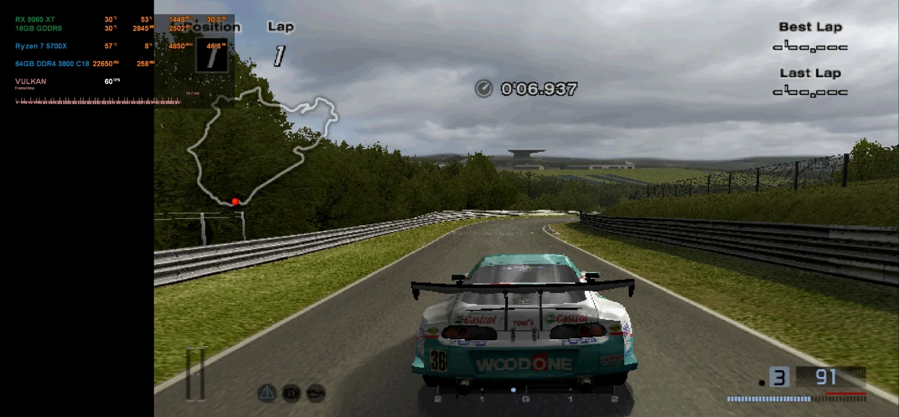
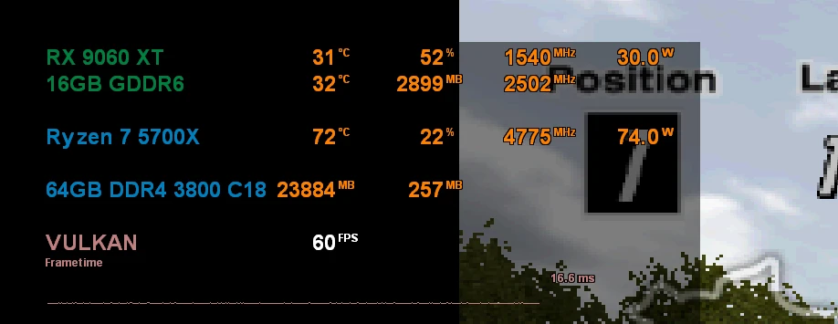

# GT4Recomp

**Gran Turismo 4, recompiled to run natively on PC — no JIT, no emulator window, full speed.**

-100%25%20AOT-2ea44f)

GT4Recomp is a static recompilation of **Gran Turismo 4 (NTSC-U, SCUS-97328)**
for **Windows x86-64**. The game's own code is translated ahead of time into C++
and compiled to native machine code; the PlayStation 2 hardware it talks to is
reproduced in software, and graphics run on **Vulkan**. Nothing generates code
while the game runs, which is also what makes future **Android and iOS** builds
possible.

**Where we are:** real boot, menus, races against AI and replays at or near
**60 FPS and full game speed**, with a **flat 16.7 ms frametime** in Time Trial on
the Nordschleife (Ryzen 7 5700X + RX 9060 XT, 480p). Night races, rally and the car
showroom are still below 60 FPS, and **license tests currently crash** while
loading their demo run. See [Scene results](#scene-results) and [Known issues](#known-issues).

[Status](docs/STATUS.md) · [Optimization plan](docs/OPTIMIZATION-PLAN.md) · [Build guide](docs/BUILD.md) · [Credits](#credits)

## Recompilation progress

How much of each PS2 processor runs as precompiled native code instead of being
interpreted at run time:

| Unit | What it does | Status | Progress |
|---|---|---|---|
| **EE** (main CPU) | Game logic, physics, menus, draw lists | Translated ahead of time to C++; no EE interpreter exists | **100%** of executed code · 5,676 unreached decomp functions to add for coverage |
| **VU0 macro** | Vector math inside EE code | Translated together with the EE | **100%** |
| **VU1 microcode** | Vertex transform, lighting, clipping (the "vertex shader") | Whole microcode image recovered from the executable; all 2,048 entry points compiled ahead of time | **100%** · 0 interpreted calls in day/night races, rally, showroom |
| **VU0 microcode** | Small helper programs | All 14 entry points compiled ahead of time with exact flags | **100%** · 0 interpreted calls |
| **IOP** (I/O CPU) | Sound, disc, memory card, USB | System libraries replaced by native code; 23 game modules interpreted | **System libraries native** · game modules later |
| **GS** (graphics chip) | Rasterization | Faithful GS emulation in Vulkan compute shaders, asynchronous submission | Hardware renderer planned |

## Performance journey

Same machine, same scene (Time Trial, Nordschleife, Supra), measured with the
built-in F7/F8 profiler:

| Step | Frame time (median) | FPS | Game speed |
|---|---|---|---|
| Starting point (VU1 interpreted, synchronous GPU) | 33.3 ms | ~30 | 51% |
| VU1 compiled ahead of time | 22.0 ms | ~45 | 75% |
| + asynchronous GPU submission | 60 VBlanks/s | 60 | 100% |
| + single-clock frame pacing | **16.67 ms** (99.6% of frames within 16–17 ms) | **60** | **100%** |

## Scene results

Owner sessions on the current build (single-clock pacing, VU1 and VU0 compiled,
async GPU), one F7/F8 interval per scene:

| Scene | FPS (VBlanks/s) | Game speed | Notes |
|---|---|---|---|
| Time Trial, Nordschleife, Supra (480p) | **60.0** | **100%** | 99.6% of frames within 16–17 ms |
| Arcade race, Nordschleife, 5 AI cars | **60.0** | **100%** | After VU1 flag elision (was 58.0) |
| Replay of that race | 59.1 | 98.5% | |
| Night race with AI cars | 58.9 | 98% | VU1 fully compiled; remaining cost is a 4.1 ms GS readback wait (paraLLEl-GS, TASK-012) |
| Rally, Grand Canyon, 1 AI car | 59.9 | 99.8% | All VU1 entries compiled (was 53.9) |
| Car showroom (rotating car) | 58.0–60.0 | 97–100% | Varies with the car shown (was 44.8 before flag elision) |

## Known issues

- **License tests crash** when the demo run loads (also with every new
  optimization disabled, so it predates them). The crash is traced to
  `RaceSolitaire::loadDemoInputs` → `AutomobileControlRecord::Manager::load`;
  the demo-input data appears to arrive wrong or late. Under investigation.
- **Night races** run at about 59 FPS: the remaining cost is a GPU readback wait
  that the new renderer (paraLLEl-GS, TASK-012) is expected to remove.
- **Car showroom** dips to about 58 FPS with some cars; a dedicated VU1 thread
  (MTVU, TASK-011) is planned.
- Menus are interlaced like the original game (480p applies in races); a
  deinterlacing filter is planned with the new renderer.
- Physical gamepads, racing wheels and long sessions are not fully qualified yet.

## Roadmap

Work is tracked as numbered tasks in [TASKS.md](TASKS.md); each task is tested
in game before it is merged.

| Phase | Platform | Renderer |
|---|---|---|
| **Phase 1** (current) | Windows PC | paraLLEl-GS (Vulkan compute); current renderer kept as experimental fallback |
| **Phase 2** | Android | ARMSX2 GS pipeline (Vulkan) |
| **Phase 3** | iOS | ARMSX2 GS pipeline (Metal) |

### Phase 1 — Windows PC

| Task | Goal | Result / State |
|---|---|---|
| TASK‑001 | Rebuild the measured baseline on the new test PC | ✅ Done |
| TASK‑002 | Record the VU1 programs the game uses while playing | ✅ Done · 86 programs captured |
| TASK‑003 | Hardened VU1 compiler with differential tests | ✅ Done · 100/100 programs compiled |
| TASK‑004 | VU1 microcode compiled ahead of time in the game | ✅ Done · 30 → 45 FPS, 0 mismatches in 140k checks |
| TASK‑005 | Asynchronous GPU submission + overlay fix | ✅ Done · 45 → 60 FPS, 100% game speed |
| TASK‑006 | Frame pacing on a single clock, rate-controlled audio | ✅ Done · flat 16.7 ms frametime |
| TASK‑007 | VU1 per-program flag elision | ✅ Done · showroom 45 → 59 FPS, 5-AI race 60 FPS |
| TASK‑008 | Full static VU1 entry coverage (all 2,048 entries) | ✅ Done · 0 interpreted VU1 calls; rally 60, showroom 60, night 59 FPS |
| TASK‑009 | Title, fixed 16:9, fullscreen, races in 480p | ✅ Done · races forced to 480p, menus 480i as original |
| TASK‑010 | Build pipeline: faster builds and tuning (CPU variants, LTO, PGO) | ✅ Done · full build 3,942 → ~1,700 CPU-s |
| TASK‑011 | MTVU: VU1 on its own thread | 📋 Planned |
| TASK‑012 | paraLLEl-GS as the PC renderer: upscaling, deinterlacing, readbacks, extras | 🔄 In progress · runs headless, textures missing |
| TASK‑013 | VU0 microcode compiled ahead of time | ✅ Done · 14/14 entries, 0 interpreted calls, 28k differential checks |
| TASK‑014 | Full EE entry coverage from the decompilation | 🔄 Stage A done |
| TASK‑015 | LWR instruction fidelity check | ✅ Done · already matches PCSX2; build audio test now silent |
| TASK‑016 | IOP per-module cost review | 📋 Planned |
| TASK‑017 | License-test crash | 📋 Planned |
| TASK‑018 | Racing wheels with force feedback | 📋 Planned |
| TASK‑019 | Launcher (Rust): renderer, resolution, video, controls | 📋 Planned |
| 🚀 | **First stable release on GitHub** | 📋 Planned |
| TASK‑020 | Decompilation names in the generated code | 📋 Planned |

### Phase 2 — Android · Phase 3 — iOS

| Task | Goal | State |
|---|---|---|
| TASK‑021 | ARMSX2 GS pipeline (Vulkan) for Android | 📋 Planned |
| TASK‑022 | Android app: touch controls, Bluetooth controllers | 📋 Planned |
| TASK‑023 | ARMSX2 Metal GS for iOS | 📋 Planned |
| TASK‑024 | iOS app | 📋 Planned |

Details: [TASKS.md](TASKS.md) · [GS renderer options](docs/GS-RENDERER-OPTIONS.md) · [Optimization plan](docs/OPTIMIZATION-PLAN.md).

## The Experience We Want to Build

- **Correct speed, smooth 60 FPS** on ordinary PCs, then on phones.
- **Configurable internal resolution** (1080p, 1440p, 4K) with real internal upscaling.
- **Clean image options:** paraLLEl-GS super-sampling, deinterlaced menus, post-processing.
- **Racing wheels** with force feedback.
- **Faithful first:** the original game, as accurate as possible, just faster and sharper.

A decompilation-based source port (native renderer, high refresh rates independent of
physics, ultrawide, remaster features) is a possible separate project later; it is not
part of this repository's roadmap.

## How It Works

The EE game code is translated ahead of time (AOT) into C++ and compiled for
x86-64. The VU1 microcode, stored encrypted inside the executable, is recovered,
compiled offline and verified against a reference interpreter on real game state
(hundreds of thousands of checks, zero mismatches). IOP system services are
native; the GS is reproduced with Vulkan compute shaders. Frames are paced by a
single high-resolution clock with rate-controlled audio. Interpreters remain only
as counted fallbacks. This is a **hybrid recompilation**: PS2 hardware is still
modeled in software, so we do not claim zero emulation or full PS2 fidelity.

For implementation details, see [Architecture](docs/ARCHITECTURE.md).

## Testing and Development

The project currently requires a **development environment with prepared private assets**. This repository does not distribute game assets, ISOs, BIOS dumps, decompiled code, prebuilt binaries, or save files. A separate [EE producer](docs/EE-PRODUCER.md) now rebuilds the translator and game library from verified inputs; production still uses its qualified private library while candidate integration and gameplay checks remain pending. A clean end-to-end playable build remains future work.

Once the environment is prepared, `Jogar-GT4.cmd` launches the game, validates required files, and preserves the existing memory card. The current build starts with `scripts/play_performance.py --mode main --force-480p` (F7 starts a measured interval, F8 reports it). Requirements and instructions are detailed in the [Build Guide](docs/BUILD.md).

| Key | Action |
|---|---|
| Enter | Start / Pause |
| Z | Confirm / Accelerate |
| A | Brake |
| S | Triangle / Back |
| X | Circle |
| Arrow Keys | Navigate / Steer |
| Alt+Enter, F11 | Toggle borderless fullscreen on the current monitor |

The presentation is fixed at 16:9; there is no 4:3 framing option. Set **Options → Screen → Aspect Ratio** in the game to 16:9. Fullscreen restores the previous windowed size and position when toggled off. Existing memory cards retain saved settings.

`--force-480p` (or `GT4_FORCE_480P=1`) holds the game's race display option at 480p: races render progressive while menus stay 480i as in the original. Without the switch the game's own setting is used.

## Credits

GT4Recomp stands on the work of others. Thank you:

| Project | Author | What it gives this project |
|---|---|---|
| [ps2-web-recomp](https://github.com/snuri00/ps2-web-recomp) (MIT) | snuri00 | The runtime foundation: the EE-to-C++ translator, PS2 hardware/service models, the GS compute renderer and the original VU1 program compiler our `tools/vu_recomp` derives from. GT4 was its first title. |
| [gt4-decomp](https://github.com/gustavocanepa/gt4-decomp) (MIT) | gustavocanepa | A matching decompilation of GT4's game code; its CORE.GT4 is byte-identical to ours ([evidence](docs/DECOMP-IDENTITY.md)). Function names, class layouts and engine notes. |
| [Nenkai's Gran Turismo research](https://github.com/Nenkai) ([gt-modding-hub](https://github.com/Nenkai/gt-modding-hub), [PDTools](https://github.com/Nenkai/PDTools), [GT-File-Specifications-Documentation](https://github.com/Nenkai/GT-File-Specifications-Documentation) and more) | Nenkai | File formats, volume and model structures, and the VU1 microcode encryption scheme that let us find GT4's whole VU1 program image ([details](docs/VU1-MICROCODE-SOURCE.md)). |
| [GT4FS](https://github.com/Razer2015/GT4FS) | Razer2015 | GT4 volume file-system research. |
| [PCSX2](https://github.com/PCSX2/pcsx2) (GPL-3.0) | PCSX2 team | Decades of PS2 knowledge; used here as a reference ([lessons](docs/PCSX2-LESSONS.md)) and as the source of Khronos Vulkan headers. |

Exact revisions, licenses and imported files are listed in [THIRD_PARTY.md](native/THIRD_PARTY.md).

## Foundations, History, and Documentation

The active runtime foundation comes from the MIT-licensed [ps2-web-recomp](https://github.com/snuri00/ps2-web-recomp) donor, adapted to native Windows and Vulkan. Our binary runs directly on Windows without a browser, WebAssembly, or embedded PCSX2. Credits, revisions, and licensing terms are documented in [THIRD_PARTY.md](native/THIRD_PARTY.md).

Development has progressed through boot and menus, Vulkan integration, audio and controls, genuine racing gameplay, and display modes. The `main` branch contains only this native base.

- [STATUS](docs/STATUS.md): Confirmed milestones and pending tasks.
- [HYBRID-PORT-PLAN](docs/HYBRID-PORT-PLAN.md): Active Windows-first no-JIT optimization, GS graphics and future Android/iOS phases.
- [NATIVE-PORT-PLAN](docs/NATIVE-PORT-PLAN.md): Preserved game-scene renderer and eventual native migration alternative.
- [AGENT-WORKFLOW](docs/AGENT-WORKFLOW.md): Model routing, task contracts, review and future unattended queue policy.
- [EE-PRODUCER](docs/EE-PRODUCER.md): Verified CORE/ISO preparation, fresh EE generation and separate library build.
- [RENDER-CONTRACTS](docs/RENDER-CONTRACTS.md): Initial model/camera mapping, state effects and open coverage gates.
- [EE-CALLBACK-COVERAGE](docs/EE-CALLBACK-COVERAGE.md): Bounded offline recovery experiment and remaining integration gates.
- [EE-CANDIDATES](docs/EE-CANDIDATES.md): Separate runtime builds and owner-controlled qualification.
- [CAR-ASSET-RESEARCH](docs/CAR-ASSET-RESEARCH.md): Bounded volume-index evidence and the one-car extraction contract.
- [NENKAI-REFERENCES](docs/NENKAI-REFERENCES.md): Pinned local reference environment, format/source map and catalogue research limits.
- [ROADMAP](docs/ROADMAP.md): Earlier timing analysis and selective migration proposal, retained as technical context.
- [ARCHITECTURE](docs/ARCHITECTURE.md): Architecture of the current base.
- [BUILD](docs/BUILD.md): Build environment setup and verification procedures.

Active source code resides in `native/`, with tooling in `scripts/`, automated tests in `tests/`, and technical records in `docs/`. The active development fork is [`moesuito/gt4-staticrecomp`](https://github.com/moesuito/gt4-staticrecomp).
