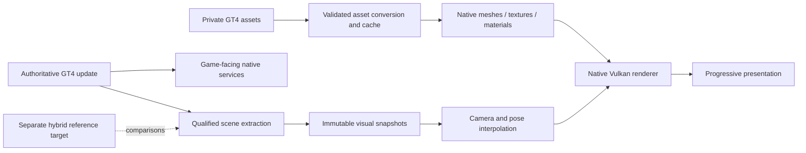

# Native Renderer and Game Port Plan

2026-10-13. Owner-requested planning, source baseline
`88c0e96f50a3dd9a3215a5f64163febd628c843c` (slice 114 lineage).
Status: proposed implementation sequence; no port, build, performance probe,
game launch, or gameplay automation performed while preparing this document.
Subsequent owner authorization started P0/P1 in slice 116; progress and limits
are linked under those phases. Later phases remain proposed.

The owner selected **Windows with an entry-level dedicated GPU, 1920x1080 at
60 FPS** as the initial hardware/performance target. Exact CPU/GPU, RAM, VRAM,
driver, and quality preset remain to be selected before benchmark acceptance.
High-refresh rendering, progressive internal resolution and ultrawide are
subsequent goals. They are not available features today. The owner clarified
that a deferred-rendering remaster is outside the current roadmap. Texture,
material and lighting upgrades require a separately scoped future proposal.

## 1. Direction and success claims

Build a game-scene renderer that receives GT4 objects, geometry, textures,
materials, cameras, and visual state before they become PS2 graphics commands.
Deliver a small live-game replacement first, expand coverage, then retire the
remaining device dependencies through explicit game-facing service contracts.
Do not spend months implementing a general-purpose native VU/GS replacement
that would itself be discarded when the game-level renderer arrives.

Keep the qualified hybrid executable as a development reference. Keeping it
available does not authorize fallback inside a release described as free of
PS2 execution emulation. Every supported configuration must have a coverage
manifest and observable unsupported-path behavior.

| Claim | Required evidence |
|---|---|
| No JIT | No runtime machine-code generation or JIT dependency in the shipping target; already true of the qualified Windows configuration |
| Native 3D renderer | Covered objects use native geometry/shaders without executing their original VU1/GS drawing path; legacy UI/effects may still exist and must be disclosed |
| No PS2 graphics pipeline | All supported graphics, including UI/HUD, movies, effects and readbacks, run without VU graphics microprograms, graphics VIF/GIF execution, GS registers/rasterization/VRAM models |
| No PS2 instruction interpretation | No reachable EE/IOP/VU instruction interpreter; all supported instruction workloads replaced or compiled offline; unknown code fails explicitly |
| No PS2 hardware emulation required | Shipping game services do not require a simulated PS2 bus, kernel, timer/IRQ/DMA/RPC or device model |
| Portable game source | Active game code uses typed native interfaces without depending on the generated guest CPU/register machinery; this is a further maintainability milestone |

AOT code can still implement hardware semantics. Removing an interpreter alone
does not eliminate those semantics. Conversely, retaining a GT4 content/script
VM is compatible with a native port: game bytecode is not PS2 CPU instruction
emulation. A renamed GS command interpreter remains a hardware model if its
contract is still PS2 registers/VRAM.

**Recommendation:** pursue native graphics for architectural freedom. Keep
targeted measurement as a guardrail and consume the delegated OpenCode findings.
The speedup from any proposed replacement is **Unknown** until measured.

## 2. Evidence baseline

**Confirmed by static source inspection and existing records:**

- Main EE code is AOT C++/x86-64. Current IOP and VU microprogram execution
  remains interpreted; Windows VU JIT is disabled. Native Vulkan currently
  implements GS-oriented compute rendering. See [ARCHITECTURE](ARCHITECTURE.md).
- VU0 macro instructions emitted by `recomp/codegen.cpp:389` and the cases
  around lines 670-720 call native C++ helpers. `Vcallms`/`Vcallmsr` enter
  separate microprogram execution. VU0 cannot be treated as one uniformly
  interpreted graphics component.
- The current build depends on the private library with SHA256
  `c837d13dae027f377aecdb0c39834ede2e9463eabf7f767fda6a3c5a0762de1f`.
  Its generation is not yet a complete public clean-checkout recipe.
- Donor revision: `1b4808793a12c45125262fd2d5f50a9ec9f7c020`.
  Local decomp reference inspected:
  `c4b82c9b90b8ad712edfb6653cafb8451379a2db`.
  Private paths are under `private/references/`; this plan does not import code.
- The owner confirms real menus/racing and 16:9 at 480i/480p/1080i. Severe
  3D performance problems are observed; their cause is not isolated.
- OpenCode owns the authorized performance investigation. Its uncommitted
  implementation work is excluded from this planning baseline and preserved.

**High confidence:** a scene-level interface is a better fit for configurable
geometry, materials and cameras than a renderer receiving already projected
GS primitives. This is an architectural inference, not proof of a working hook.

**Hypothesis:** a bounded opaque-car showroom path is the smallest useful live
integration. Its exact entrypoint, dependencies and composition must be qualified.

**Unknown:** update/render separation, true physics cadence, remaining graphics
readbacks, complete render coverage, portable decomp coverage, minimum hardware,
and achievable performance after migration.

### Candidate boundaries, not approved hooks

| Candidate | Address in local decomp reference | What is known / what needs proof |
|---|---|---|
| `ModelSet2__render` | `0x00455528` | Begin/loop/internal-render/end wrapper; names inferred from cross-game analysis; internal render semantics unresolved |
| `ModelSet2___render` | `0x00455708` | Candidate detailed model processing; packet generation, callbacks and side effects not established |
| `CameraBase__getProjectionMatrix` | `0x0044F210` | Recovered code calls `o->update(t)`; must not assume a pure getter or call it for every extra visual frame |
| Camera model-view candidate | `0x0044F280` | Matrix layout/conventions, ownership and time dependence need verification |
| Race render/world/cars candidates | `0x0033D970`, `0x0033DEA8`, `0x00340950` | Naming/call-graph leads; not established independent update/render entrypoints |

The decomp describes a different disc revision. Prior study metadata records
CORE correspondence, but workers must verify actual inputs, symbols and code
bytes before applying any address. A shared engine binary would not prove
identical assets, scripts, save formats or all disc contents. Matching source
compiled for PS2 is not automatically portable x86-64 source.

## 3. Intended architecture

These are proposed responsibilities, not existing classes. Keep one scene
bridge until its contract demonstrates a need for additional abstractions.
Use stable resource/instance IDs, explicit versions and lifetimes, validated
guest-address reads, and native buffers that do not alias mutable game memory.
Callbacks run at their qualified cadence exactly once. Snapshot consumers
must never update physics, invoke script callbacks, or mutate guest state.

The graphics bridge translates game material/shape semantics. Parsing packed
VIF-derived asset data offline is acceptable; executing a virtual VIF/VU/GS
pipeline on every draw does not meet the native graphics milestone.

Preserve required completion and feedback behavior while the old runtime is
active. Identify real consumers of GS downloads, SIGNAL/FINISH/LABEL, mirrors,
photo mode and render-to-texture. Returning invented results or simply disabling
their interrupts is not a valid migration. Replace each operation's game-level
purpose before retiring its device path.

## 4. Phases and exit gates

Each phase produces reviewed code, controls, provenance and an owner-operable
candidate where applicable. Subsequent phases can be planned, but dependent
implementation cannot advance past an unresolved semantic gate.

### P0 — Reproducible EE producer and migration contracts

**Progress (slice 116):** [EE Producer](EE-PRODUCER.md) establishes independent
input reconstruction, fresh translator/source/library production. Coverage omissions,
candidate runtime integration, native checks and owner gameplay keep this phase open.
**Slice 117:** [Callback Coverage](EE-CALLBACK-COVERAGE.md) recovers one omitted
pair in four offline profiles and compiles the changed units, without production integration.
**Slice 118:** [EE Candidates](EE-CANDIDATES.md) integrates separate baseline/
recovered runtime profiles; gameplay and remaining coverage still gate completion.

**Dependencies:** current build/inputs and read-only reference inventory.
**Work:** recover generator options, entrypoints, indirect targets, registration,
compiler flags and necessary private preparation. Generate and compile the EE
in a fresh producer directory. Separate baseline pins from new candidate pins;
do not loosen hash validation or overwrite the old library. Establish task,
coverage and provenance manifests, and qualify worker models on small tasks.

**Exit:** a documented generation/build recipe with all inputs/tools/revisions;
generated coverage and unsupported-code checks; existing active tests pass;
owner confirms menus/showroom/race behavior on the candidate. Bit-identical
binaries are not mandatory when metadata differs, but semantic differences
must be explained. Missing private prerequisites cause a clear failure.

**Risk:** incomplete function recovery and indirect dispatch. Returning zero
or adding permissive fallback to make boot pass is prohibited.

### P1 — One-car render contract and asset understanding

**Progress (slice 116):** [Render Contracts](RENDER-CONTRACTS.md) maps seven static
candidates and their local effects. Concrete car data, ownership, conventions,
complete callback dependencies and observation-hook qualification remain open.
**Slice 118:** [Car Asset Research](CAR-ASSET-RESEARCH.md) verifies volume-index
metadata but leaves page decoding and the named-car/live-instance mapping open.
**Slice 119:** [Nenkai References](NENKAI-REFERENCES.md) pins six research checkouts.
Bounded private catalogue decoding and independent directory/file-bound checks
now pass; car/SpecDB directory leads are observed. A production reader, named-car
crosswalk, payload parsing and live-instance mapping remain open.

**Dependencies:** P0 for executable hooks; static research may start earlier.
**Work:** map one model boundary to actual generated EE functions and callers.
Establish coordinate spaces, transforms, bounds, vertex packing, strip breaks,
normals/colors/UVs, materials, texture palettes/mips, LOD and instance ownership.
Identify ModelSet2 VM/callback animation and all state changes in the boundary.
Plan read-only extraction while the original path remains authoritative.

**Exit:** reviewed pre/postconditions, side-effect ledger and mapping of one
real car's mesh/texture/camera data. Synthetic fixtures independently specify
matrix multiplication, handedness, clipping, packing and invalid-data behavior.
Camera/model callbacks are never evaluated twice for comparison.

**Risk:** a getter can update state; static exported models can omit live
callbacks. An offline viewer proves decoding only, not live integration.

### P2 — Native resource conversion and forward Vulkan foundation

**Dependencies:** P1 contracts; pure decoder fixtures can start in parallel.
**Work:** bounds-checked decoders and private conversion caches keyed by content,
schema version and converter revision. Native vertex/index buffers, original
textures, explicit material state, depth, alpha test/blend and camera uniforms.
Use vertex/fragment shaders for the normal drawing path. Start with a scalable
forward renderer, stable resource reuse and bounded frames in flight.

**Exit:** independent primitive/depth/texture/blending fixtures on the GPU,
shader/compiler pins, validation-layer checks where supported, and tests for
resize, resource retirement, device failure and unsupported capabilities.
Geometry counts, bounds and texture results agree with independent decoding
controls. No dependence on a high-end-only graphics feature without fallback.

**Risk:** using host structs over packed guest memory, retaining stale resources,
and accumulating shader variants. CPU/GPU synchronization has explicit ownership;
removing fences alone is not a design.

### P3 — A live car drawn by the new renderer

**Dependencies:** P0-P2.
**Work:** intercept the approved opaque-car path, preserve its gameplay/state
effects and replace its drawing with native meshes/materials. Validate depth
and composition with the remaining scene. Restrict the first scenario when
shared depth or mixed pipelines cannot yet be made correct.

**Exit:** owner switches real car selection and camera inside the showroom;
the selected body uses current game instance data, not a frozen export. Counters
and a coverage ledger show that the replaced draw path does not also execute
VU1/GS drawing. Original appearance and non-graphics state remain qualified.
Feature flag and developer reference rollback are explicit.

**Risk:** overlaying a second car on the old render or performing both pipelines
is not a successful replacement and can hide performance costs.

### P4 — One complete racing scenario

**Dependencies:** P3; track/other material research can proceed independently.
**Work:** one track, player and opponents, wheels/poses, world placement,
visibility/LOD, sky, vegetation, shadows, reflections/mirror, transparent objects,
particles and required effects. Native 3D can initially compose with disclosed
legacy HUD/UI. Preserve object/pass ordering where it affects appearance.

**Exit:** owner completes a selected race and checks collisions, timing, camera
changes, opponent behavior and save/return flow. Offline scene/material fixtures
cover the scenario. Counters, CPU/GPU timings and memory measurements show which
paths are replaced; no claim of complete game coverage follows from one track.

**Risk:** render callbacks can drive animation or events. Graphics migration
must not advance, omit or duplicate simulation work.

### P5 — Progressive output, internal resolution, ultrawide and launcher

**Dependencies:** P3 for early prototypes; P4 for race acceptance.
**Work:** full-frame progressive native targets independent of PS2 scanout;
configure internal color/depth/effect targets and presentation separately.
Offer 1080p baseline, then 1440p/4K as optional profiles. Apply aspect-aware
projection, visibility/culling and an explicit HUD safe-area/anchor policy.
Keep 16:9 default and optional 4:3; qualify ultrawide gameplay separately.
Launcher settings must not silently rewrite or reseed the owner's card.

**Exit:** real internal dimensions verified, aspect/culling/HUD fixtures and
owner checks at multiple resolutions/aspects. No stretched HUD or interlaced
field dependence in the native path. Menus/races/transitions and resize work.
No guest clock/VBlank change is used to claim progressive output.

**Risk:** widening the camera can expose missing geometry or change original
visibility selection. Upscaling a completed low-resolution framebuffer does
not satisfy internal-resolution support.

### P6 — Separate simulation, scene construction and presentation

**Dependencies:** P1 contracts and P4 scene coverage; design can start earlier.
**Work:** establish original update cadence and map physics, AI, collision,
timers, input, camera, animation, scripts and audio. Use a monotonic host clock
and fixed qualified simulation steps, with bounded catch-up/backpressure.
Render immutable previous/current visual state at display cadence. Define
interpolation latency and reset history for pauses, teleports and transitions.

**Exit:** controlled-clock offline tests at 30/60/120/144 presentation caps
produce identical authoritative states at the same simulation steps for identical
recorded inputs. Test recordings are offline fixtures, not automated live input.
Owner verifies real-time speed, race/audio/input behavior and new intermediate
views at supported refresh rates. No duplicate scanout is counted as a new scene.

**Risk:** calling old rendering functions more frequently can mutate gameplay.
Snapshot interpolation never writes back into physics. Insufficient CPU capacity
still prevents 100% real-time speed; no timing policy can promise otherwise.

### P7 — Complete graphics coverage and retire PS2 graphics execution

**Dependencies:** P4-P6; each content category has its own gate.
**Work:** expand cars/tracks/weather/effects and alternate modes; move menus,
fonts, HUD, movies, replay, photo/render-to-texture and transition composition
to native drawing/services. Replace every graphics feedback/completion contract.
Maintain a matrix of covered modes/content and explicit unsupported cases.

**Exit:** a release target can exclude GS raster/VRAM and all graphics uses of
GIF/VIF and VU microprogram execution. Link-dependency audit, disabled-reference
builds and execution counters agree across the declared qualification matrix.
Developer comparisons can remain in a separate target. Legacy HUD composition
or a hidden interpreter fallback means this gate has not passed.

Shared VIF infrastructure may still feed non-graphics VU computations. Its
complete removal requires P8's caller inventory and migration gates; do not
confuse zero graphics use with proof that no other caller remains.

**Risk:** static reachability is insufficient for data-driven branches and
dynamic content. Coverage cannot be inferred from a function percentage.

### P8 — Native services and remaining VU/IOP workloads

**Dependencies:** P0 plus per-service contracts; can progress alongside graphics
after shared state/ownership are established. No blanket device rewrite.

| Service/workload | Native replacement and acceptance |
|---|---|
| Files/archive streaming | Game-facing asynchronous I/O, validated assets, completion/error/order tests; replace actual disc/RPC dependencies |
| Save/card | Transactional persistence, imports/export compatibility where required, backup/lock/crash recovery; never use the owner's card as a test fixture |
| Pad/input | Native game-facing button/analog events, qualified cadence; physical XInput, disconnect/reconnect and duplicate-trigger controls |
| Wheel/force feedback | Recover game force outputs, map supported Windows wheel API/device capabilities, qualify actual hardware; XInput rumble is not steering torque |
| Audio | Recover voices, samples, mixer/control timing; native synthesis/mixing/streaming with correct pitch, loop points and sustained continuity, beyond the existing PCM output adapter |
| Movies/codecs | Native licensed codec path and synchronized audio/video, or qualified offline conversion; remove actual IPU dependency |
| Non-graphics VU0/VU1 | Replace game computations with typed native routines; preserve numerical behavior and outputs used by physics/animation |
| IOP modules/services | Inventory reachable modules/imports/RPC/DMA effects; replace game-facing functions and their completion contracts individually |

**Exit per service:** behavior/error/order tests and owner qualification where
required; no unhandled call falls through silently. **No-interpreter exit:** all
reachable PS2 instruction workloads covered, shipping interpreter dependencies
disabled. Offline AOT can be a temporary bridge for difficult residual workloads;
it does not satisfy the later no-hardware-model claim. Never introduce a JIT.

**Risk:** dynamic microprograms/modules require content-based identity and complete
variant accounting. Unknown programs fail explicitly in a claimed native release;
an observable interpreter is permitted only in the separate developer reference.

### P9 — Portable game core and retirement of remaining hardware models

**Dependencies:** P7-P8 and a dependency ledger showing remaining callers.
**Work:** progressively replace guest ABI/register-centric EE functions with
typed native code, reusing qualified decomp findings and established service
interfaces. Preserve physics, AI, collision, scripts, progression and save behavior.
Retire bus/device-timer/IRQ/DMA/RPC scheduling when their final game-facing callers
are migrated. Safe address/asset adapters may remain if they do not execute devices.

**Exit:** supported gameplay builds and runs without PS2 CPU/micro interpreters,
hardware/device models or generated guest CPU machinery required by the portable
core. Assert forbidden dependencies at build time; test functional contracts and
full progression/save scenarios. Keep reference executables isolated for regression
investigation. Dead or unsupported features are disclosed, never counted as ported.

**Risk:** this phase can become larger than the renderer project. AOT and partial
decomp remain useful intermediate releases; no need to delay P3-P7 until the entire
engine is readable. State hashes are compared only where representations/semantics
make equivalence meaningful; independent behavior controls remain necessary.

### P10 — Low-hardware release qualification

**Dependencies:** P4/P5 for initial race/resolution qualification, P7 for
comprehensive graphics; P9 is required for the strict full-port claim.
**Work:** qualify the lightweight forward renderer with original content,
bounded resource use, progressive resolution, supported aspect ratios and
independent simulation/presentation timing. Deferred rendering and remaster
content/effects are outside this roadmap and require a separate future proposal.

**Exit:** owner-selected entry-level PC sustains the agreed 1080p/60 profile at
correct game speed with qualified frametime, memory and long-session behavior.
Publish exact hardware/settings, supported refresh rates and
limitations. Minimum requirements follow measurements, not a promise based on AOT.

**Risk:** render-target memory, shader compilation and extra visibility
at ultrawide can consume the savings from migration. Higher-resolution presets must
not become mandatory for the original-experience preset.

## 5. Dependencies and parallel work

Critical path: **P0 -> P1 -> P2 -> P3 -> P4 -> P7**, with P5/P6 joining race
qualification before high-refresh/ultrawide release. P8 is a per-service parallel
track once contracts are stable. P9 combines retired graphics/services with a
portable core; P10 can develop optional visuals earlier while keeping claim gates.

Parallel read-only queues: EE recipe, symbol mapping, asset formats, service
inventory, licensing, fixture design and qualification coverage. Parallel patch
proposals are permitted for independent approved contracts. One repository
integrator applies changes, and builds/tests execute serially. Do not run a second
performance investigation beside the owner-delegated OpenCode task.

Start with a small pilot queue. Increase worker count only when enough approved
independent tasks exist and reviewer throughput can keep up. More tokens do not
resolve an unknown contract. See [Agent Workflow](AGENT-WORKFLOW.md) for model
routing, task templates, escalation and unattended-work boundaries.

## 6. Performance and qualification policy

The initial target is a goal, not a benchmark result. Before accepting it, pin
CPU/GPU, driver, memory, Vulkan features, resolution, preset, game build, car,
track/mode, test duration, thermal/power conditions and instrumentation overhead.
The current Vulkan 1.2 plus swapchain-maintenance requirement is a compatibility
constraint to evaluate; do not assume entry-level hardware supports every extension.

Proposed budget/gates, to refine with the selected machine and actual traces:

- 60 FPS has a 16.67 ms interval. CPU and GPU work must each fit their scheduled
  deadlines with headroom; overlapping stages are not simply summed.
- Record CPU simulation/scene/driver time, GPU pass time, blocking waits and
  presentation intervals separately; report p50/p95/p99, hitches and context.
- Verify game time/wall time near 1.0 over sustained running windows, with an
  explicitly chosen tolerance and pause/loading exclusions; FPS alone is insufficient.
- Measure cold/warm shader/cache behavior, RAM/VRAM, load time and long sessions.
  Numeric memory budgets remain TBD until the entry-level machine is selected.
- Qualify complete races, menus/transitions, saves/reloads, audio continuity,
  cameras, multiple cars/tracks, and controller hardware, not only a single frame.
- Compare original-appearance workloads before attributing savings. Validate
  independently against qualified behavior/reference evidence where available.
  Agreement between two paths sharing a runtime is not full PS2 fidelity proof.

Synthetic GPU tests and offline state fixtures can be automated. **All live
gameplay is owner-controlled:** no Computer Use, GUI automation, synthetic input
or scripted navigation. Each candidate includes short manual steps and metric
collection instructions. Preserve existing sessions/cards/backups/locks; launching
a tested candidate is allowed only when it does not interfere with a live session.

## 7. Risks, decisions and scope control

| Risk | Control / decision point |
|---|---|
| Inferred symbol is wrong | Verify code bytes, callers and side effects before hooking |
| Dynamic model/scene behavior lost | Preserve callback/VM cadence and live instance identity |
| Mixed graphics paths disagree | Explicit color/depth/order/feedback contracts; restrict first slice if necessary |
| Numerical changes affect gameplay | Independent numerical fixtures and behavior checks; no host UB as guest semantics |
| Full service port overtakes renderer | Keep separate milestone tracks and publish intermediate claims accurately |
| Cheap worker produces plausible errors | Mechanical controls plus independent semantic review; escalate early |
| Branch/build conflicts | Single integration writer, isolated patch proposals, serial outputs and immutable producers |
| New features exceed low-hardware budget | Lightweight forward preset, optional effects and measured resource limits |
| Reference licensing incompatible | Check each source/license before adoption; PS2Recomp GPL code remains unlinked |

There is no defensible completion date yet. The first live-car milestone supplies
information needed to estimate race migration. Track reviewed contracts, covered
features, rejected hypotheses and owner-qualified candidates rather than raw
function counts, token volume or commit frequency.

Planning is authorized. This document does not start all executable phases,
cancel the OpenCode investigation, configure paid providers, dispatch external
workers or schedule unattended jobs. The recommended first implementation package
is **P0 plus the bounded P1 research**, followed by one-car native rendering.

## 8. Primary references and limits

- [Active architecture](ARCHITECTURE.md), [build](BUILD.md),
  [previous timing roadmap](ROADMAP.md), and
  [external study](reverse-engineering/external-recomp-acceleration-2026-10-12.md).
  Existing pins/evidence are inherited, not requalified by this planning pass.
- [ps2-web-recomp](https://github.com/snuri00/ps2-web-recomp): frozen MIT donor;
  local source locations above refer to the pinned revision, not latest upstream.
- [gt4-decomp](https://github.com/gustavocanepa/gt4-decomp): matching-source and
  naming reference. Author-reported match progress is not native port coverage.
- [Nenkai: GT model format](https://nenkai.github.io/gt-modding-hub/blog/2023/11/26/lifting-bonnet-on-gt-models/)
  and [model tools](https://nenkai.github.io/gt-modding-hub/ps2/models/): ModelSet2,
  packed shapes, materials and callback/VM research; verify tool licenses before reuse.
- [OpenGTPS1 renderer design](https://github.com/GTTeancum/OpenGTPS1/blob/main/docs/MODERN_RENDERER.md):
  conceptual example of game-level geometry/camera migration; no code imported
  and no claim that its PS1 implementation solves GT4's PS2 contracts.
- [Khronos synchronization](https://docs.vulkan.org/guide/latest/synchronization.html):
  resource/execution synchronization principles, not this project's performance evidence.
- [Fix Your Timestep!](https://gafferongames.com/post/fix_your_timestep/):
  fixed-step/interpolation concepts, not evidence of GT4's internal update cadence.

External pages accessed 2026-10-13. Imported implementations require individual
revision/license/provenance records and preserved attribution. Private game assets,
translated/decompiled game output, captures, cards and binaries remain untracked.
